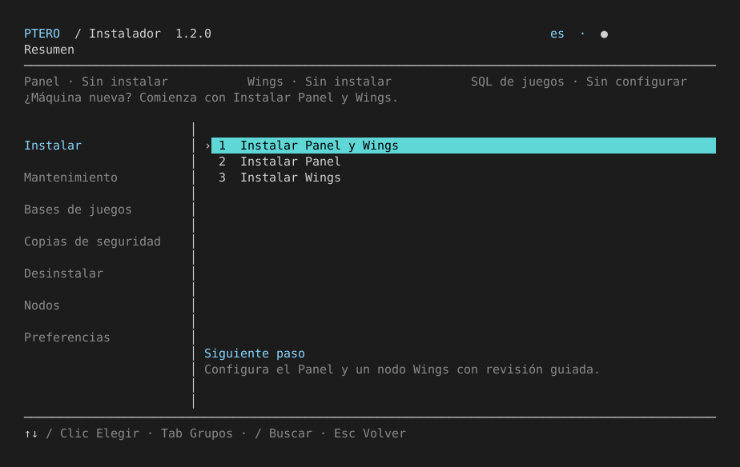

# Pterodactyl Installer

**1.2.1** · Guided installation and maintenance of Pterodactyl Panel v2 and Wings on Ubuntu and Debian.

An interactive terminal interface in **English, Español and Português (Brasil)**, with keyboard navigation, grouped actions, editable forms and animated task progress.

## Install

Run on your server:

```bash
curl -fsSL https://raw.githubusercontent.com/raimondarias/pterodactyl-installer/main/install.sh -o ptero-setup.sh && sudo bash ptero-setup.sh
```

The first question is **“Which language would you like to use?”**. The bootstrap downloads and verifies only the selected language package, then starts the installer in that language.

- **Standalone (Recommended)** or Docker; simple and advanced setup.
- **MariaDB (Recommended)** or MySQL, selected once for Panel and games.
- Public IPv4 with HTTP, or a domain/subdomain with optional Let's Encrypt HTTPS.
- First administrator, optional SMTP and separate game database host registration.
- Automatic node creation, verified SSH provisioning and resumable installation phases.
- Native or Docker game SQL host provisioning and automatic Panel registration.
- Panel and Wings-configuration backups, encrypted schedules and guided Panel recovery.
- Install, update, diagnose and remove managed components.

Maintenance, backup, removal and node operations are implemented. A fresh machine shows the installation prerequisites for each action; install the required component before using its maintenance tools.

Backups cover the Panel and Wings configuration only. Hosted servers’ files, volumes and databases are managed separately through Pterodactyl or your own backup system.

Panel v2 is currently beta; the wizard requests explicit acceptance. This independent project is not affiliated with Pterodactyl.

## Try the full preview

Download the launcher and run without sudo:

```bash
curl -fsSL https://raw.githubusercontent.com/raimondarias/pterodactyl-installer/main/install.sh -o ptero-setup.sh && bash ptero-setup.sh --preview
```

Walk through the real Panel questions, Wings linking and simulated operations. No packages or services are installed; simulated settings, credentials and backups live only in memory. Python 3 must already be available. Use sample credentials.

On a terminal, the preview is interactive. Redirected input runs an automatic tour. [Preview guide](docs/PREVIEW.md).

## Requirements and controls

Ubuntu **22.04 / 24.04 / 26.04** or Debian **12 / 13**, amd64 or arm64, with systemd. Allow at least **4 GiB free disk** and **2 GiB RAM** before game workloads. Installation requires root; Wings requires a host capable of running Docker. [Deployment requirements](docs/OPERATIONS.md#supported-hosts).

**Ubuntu 26.04:** use Docker unless PHP 8.3/8.4 packages are already configured; its native PHP repository is currently unavailable.

**Click an option to select it** in terminals with mouse support, including the startup language picker. Use **↑↓** to navigate, **Tab / ←→** for groups, **Enter** to select, **/** to search and **Esc** to return. A terminal of at least **60 × 18** supports full-screen mode. Add `--plain` for numbered prompts or `--no-animation` to disable movement.



## Documentation

- [Installation and operations](docs/OPERATIONS.md) · [Español](docs/ES.md) · [Português](docs/PT-BR.md)
- [Nodes, recovery and backups](docs/ADVANCED.md)
- [Full preview](docs/PREVIEW.md) · [Terminal interface](docs/TUI.md)
- [Testing](docs/TESTING.md) · [Verification report](test-results/REPORT.md)
- [Changelog](CHANGELOG.md) · [Releases](https://github.com/raimondarias/pterodactyl-installer/releases)
- [Roadmap](docs/ROADMAP.md)

A real Ubuntu 24.04 standalone deployment runs at [installer.xerosrv.com](https://installer.xerosrv.com). See the verification report for completed fresh-system tests and infrastructure limits.

[MIT License](LICENSE)
