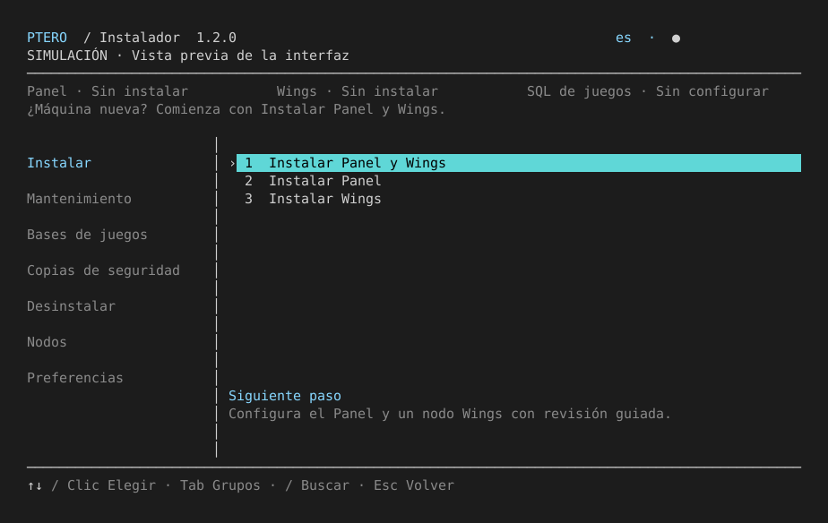
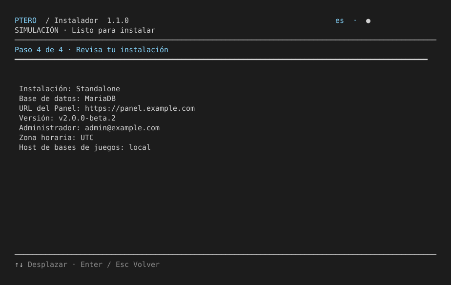

# Full installation preview

The Pterodactyl Installer preview uses the production Panel question collector and node-linking form. Package installation, downloads from upstream, certificate issuance and service changes are replaced by animated simulation stages. Runtime language packs may be downloaded by the online launcher.

```bash
bash ptero-setup.sh --preview
```

From a source checkout:

```bash
bash scripts/run_local.sh --preview
```

Python 3.10+ must already be installed. The preview never installs missing Python, including when launched as root. No sudo is needed. Use invented credentials and example domains: the simulation does not contact the Panel, SMTP server or game SQL host. Public-IP detection is replaced by a clearly labelled sample address.

## Interactive walkthrough

1. Select English, Spanish or Brazilian Portuguese. In the online launcher, this happens before the selected language package downloads.
2. Open **Install → Install Panel and Wings**. The title displays **PREVIEW** throughout the session.
3. Choose **Simple** or **Advanced**, **Standalone** or **Docker**, and one database engine for Panel and games.
4. Review the Panel beta notice. With Advanced, choose a Panel release. Release discovery uses simulated metadata; it does not verify availability.
5. Choose a domain/subdomain or public IPv4. Domain mode asks about HTTPS and DNS readiness. Advanced also offers PHP for standalone, HTTP port when applicable, listening IP and timezone.
6. Enter the first administrator's email, username and masked password. Empty passwords generate credentials; entered passwords require confirmation.
7. Optionally configure SMTP. Choose an isolated local game SQL host, an existing remote host, or configure it later. Advanced exposes host name, port, provisioning credentials and node association. The engine is not asked a second time.
8. Review the summary and type the localized installation phrase. Animated stages simulate dependencies, SQL/cache, Panel deployment, migrations, web services and database-host registration.
9. Select the Wings release and deployment mode. Confirm installation, then optionally enter the Panel URL, node ID and sample Auto-Deploy token. HTTPS certificate questions can also be explored.
10. Return to the overview. Simulated installed components enable their maintenance, database, backup and removal actions. Try a Panel backup, remove the simulated Panel, then restore it from memory. **Preferences → Reset preview** clears the whole scenario.

No files are created for simulated backups or credentials. Game SQL remains in preview memory after removing the Panel, matching its independent lifecycle. Exiting clears the session. Diagnostic and log screens show sample information, not host health. Production operations have additional real host, release, network and service checks; the preview cannot validate a real deployment.

Click an option, or use arrows and Enter for choices, Esc to cancel a form, `/` to search actions and Tab to change groups. The same preview works with `--plain`; add `--no-animation` for reduced motion. Keep stdin attached to a terminal for interactive questions.





## Focused scenarios

```bash
bash ptero-setup.sh --preview --language es install-panel
bash ptero-setup.sh --preview --language en install-wings
```

A direct action runs in a fresh simulated session and exits. Maintenance exploration is available through the preview menu after a simulated installation.

## Automatic text tour

Redirect stdin to run the complete scripted sample without answering prompts:

```bash
bash scripts/run_local.sh --language en --preview --no-animation < /dev/null
```

The tour follows advanced standalone setup, MariaDB, HTTPS, administrator confirmation, SMTP, local game SQL, Wings linking and certificate questions, then simulated backups and diagnostics. All three languages are supported. Password input is represented by masked text; generated game SQL credentials are demonstration values. A text file cannot display terminal animation; use an interactive SSH terminal to see the effects.

## Advanced scenarios

The preview also offers node resource/allocation forms, native game SQL selection, scheduled encrypted Panel/Wings-configuration backup questions, remote SSH/private-SQL planning, resume and health screens. Backup planning and node resource questions share the production collectors. Preview SSH key paths are placeholders; no key files are opened or remote connections made.

The backup menu covers Panel and Wings configuration only. It has no game-volume or game-database backup/restore actions. Scheduled backups offer the same scope, including a Wings-only scenario. Maintenance actions become ready after their required simulated component is installed.
