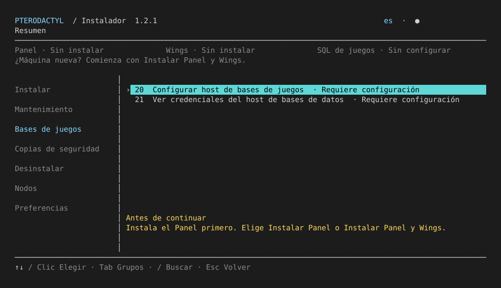
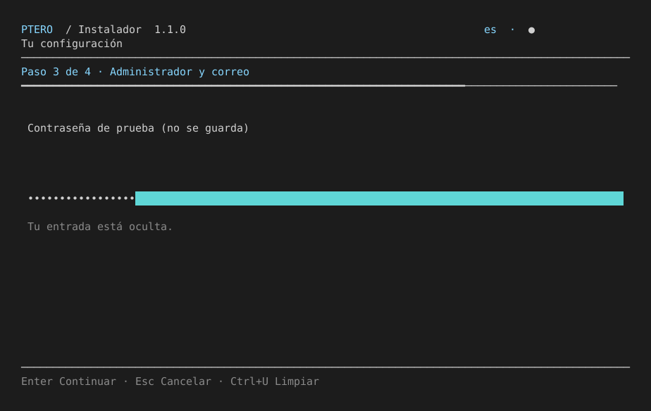

# Terminal interface

**Pterodactyl Installer** opens a full-screen **ncurses TUI** by default, using Python's
standard library. It needs no pip packages, Node runtime or browser.


The images on this page are captures of the actual ncurses screen buffer, not
design mockups. Motion is visible in the running terminal, not these static images.

## Navigation

| Key | Behavior |
| --- | --- |
| ↑ / ↓, J / K | Move within the current action group |
| Tab, ← / → | Switch groups |
| Enter | Choose the focused action or submit a field |
| Number, then Enter | Use an existing action ID, including 14, 20 and 23 |
| / | Search translated action names/descriptions across groups |
| F5 | Refresh the read-only installation inventory |
| Esc / Q | Return from a menu, or exit the overview |
| Home / End | First/last option; cursor movement in fields |
| Ctrl+U | Clear the current field |
| Page Up / Down | Scroll an operation's results |

The first language screen remains in English and appears before downloading
runtime code. In a compatible terminal it also supports arrows and Enter.
Choosing Spanish or Brazilian Portuguese changes the subsequent questions,
descriptions, state labels, field hints, confirmations and results.

## States and prerequisites

The overview reports whether Panel, Wings and local game SQL are configured.
**Configured is not a claim that a service is healthy**: use Diagnostics to check
service health. No live service commands run just to paint the menu.

On a new machine, start from **Install Panel and Wings** or **Install Panel**.
Every listed operation is implemented. Maintenance and game SQL actions explain their installation prerequisites; the status describes the current machine, rather than an unfinished feature. Selecting action
20 before installing a Panel shows the instruction to install it first; it never
tries to load a missing `panel/state.json`. Direct commands have the same guard.



Fresh-machine diagnostics show architecture, disk space, system-manager detection
and an installation suggestion. They do not install packages or modify firewalls.
Corrupt managed state is shown as requiring attention rather than being silently
treated as a fresh machine.

## Forms, review and progress

Fields support Unicode input and editing. Passwords are masked; they are not
printed into terminal output by the editor. Typed passwords still require the
existing confirmation/validation rules.



The final plan review and generated administrator password are explicit
acknowledgement screens before deployment. Destructive operations still require
their existing written confirmation phrases. Previewing the UI never invokes an
installation backend.

Long commands show the current task, elapsed time and animated activity. The
wizard shows its actual step count; the interface does not invent installation
percentages for tasks of unknown duration. A legacy interactive subprocess
temporarily suspends ncurses and restores it afterward.

Results remain on screen for inspection and scrolling before returning to the
overview. They are not immediately replaced by another 23-line menu. Private
installer logs remain separate from the UI.

## Compatibility and reduced motion

- `--plain` forces the numbered prompt interface and preserves action IDs.
- `--no-animation` keeps the full-screen keyboard UI with decorative motion off.
- Redirected/non-TTY output and `TERM=dumb` automatically use numbered prompts.
- The full-screen interface starts at **60 columns × 18 rows** or larger.
  At 95 columns and above, categories appear in a sidebar. Narrower terminals
  use a compact category selector. Resize is handled while running.
- If ncurses cannot initialize, terminal modes are restored before falling back.
- Normal exit, errors and interrupts restore terminal echo/canonical input and
  cursor visibility. There is no deliberate introduction delay.

If an SSH client still shows a numbered menu, check that stdin/stdout are attached
to a terminal, that `TERM` describes a supported terminal, and that its size is at
least 60×18. Reconnect with a normal interactive SSH terminal rather than piping
installer input/output.

Try the actual interface without installing services:

```bash
bash ptero-setup.sh --preview
```

Or from a source checkout:

```bash
bash scripts/run_local.sh --language es --preview
```

The test suite exercises real ncurses sessions in pseudoterminals as well as
plain-mode and model tests. Actual package installation, certificates and running
a game still require the clean-VPS procedure in [TESTING.md](TESTING.md).

Screenshots can be regenerated inside a real terminal, for example:

```bash
python3 scripts/capture_tui.py --language es --scene overview --output docs/images/tui-es.svg
```

[Python ncurses documentation](https://docs.python.org/3.10/library/curses.html).

The preview opens the full grouped operations menu and uses production setup forms with an in-memory simulation backend. See the [complete preview walkthrough](PREVIEW.md). All preview screens carry a persistent localized PREVIEW marker.

## Mouse selection

Click an option to choose it, including startup languages, installation choices and Yes/No prompts. Click sidebar groups to switch sections; use the mouse wheel to move through options. On compact layouts, click the arrows beside the group name. Actions requiring setup explain the missing prerequisites. Typed confirmations and password fields require keyboard input. Mouse support depends on your terminal/SSH client; keyboard controls remain available. Mouse tracking is disabled when exiting or cancelling.
